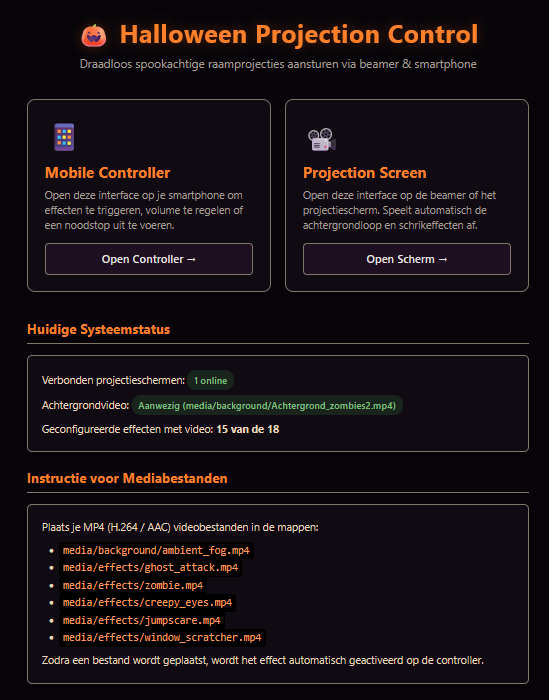
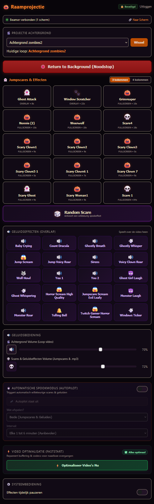

# 🎃 Halloween Projection Control

A standalone, robust, and atmospheric web application for wireless, real-time control of Halloween window projections, jumpscares, and overlapping sound effects on a projector or external display using your smartphone.

> 🤖 **100% Vibe Coded**: This entire project was built from scratch using AI (*"vibe coding"*). *No prior coding knowledge was used for this setup* — purely conversational prompting, testing, and iterating.

<p align="center">
  
  &nbsp;
  
</p>

---

## 🌟 Key Features

- **Two Dedicated Interfaces**:
  - `/screen`: Fullscreen, borderless, pure black background (`#000000`), dual-layer video player for continuous ambient loops, seamless crossfades, and overlapping audio.
  - `/control`: Atmospheric dark haunted-house mobile dashboard (black, pumpkin orange, and blood red), optimized for one-handed smartphone control with haptic vibration feedback.
- **No Artificial Time Limits or Wait Times**:
  - **0-Second Cooldown**: No mandatory wait time between scares. Trigger effects whenever you want.
  - **Full Playback Duration**: Scares are never prematurely cut off. The engine automatically reads the true video length from the MP4 metadata (`mvhd` atom) and plays the complete video smoothly.
  - **Instant Override**: Tapping a new scare immediately cancels the previous effect and launches the new one instantly (`force: true`).
- **Seamless Dual-Layer Video Player (Zero Black Screen)**:
  - Two parallel background video players with smooth CSS crossfades.
  - During a jumpscare, the background remains visible until the first frame of the scare video actually decodes and renders.
  - Smooth fade back to the background approximately 0.7s before the scare video ends.
  - **Live Background Switching**: Switch between different background loops in `media/background/` on the fly from the mobile controller.
- **🔊 Overlapping Sound Effects (.mp3)**:
  - Play standalone sound effects (screams, witch cackles, wolf howls, thunder) through a dedicated polyphonic audio pool.
  - **Polyphonic & Non-Blocking**: Playing a sound effect does **not** interrupt or mute the active background or jumpscare video.
  - **Visual Highlight & Toggle-to-Stop**: Playing sound effects pulse with a purple glow on the controller. Tapping a pulsing button a second time immediately stops that specific sound effect.
  - **Automatic Sync**: Buttons turn off automatically on all connected devices when a sound effect finishes.
- **🎚️ Independent Volume Controls**:
  - Two separate volume sliders on the mobile controller:
    1. **Video Volume**: For the background loop and jumpscare videos (with mute toggle).
    2. **🎵 Sound Effects Volume (.mp3)**: Dedicated volume control for standalone audio effects.
- **📱 Responsive Grid Layout (3 or 4 Columns)**:
  - Switch between a 3-column or 4-column button layout to fit your phone screen size. Your preference is remembered across sessions via `localStorage`.
- **🔍 Zero-Config Dynamic Media Discovery**:
  - Simply drop a new video (`.mp4`, `.webm`) into `media/effects/` or `media/background/`, or an audio file (`.mp3`, `.wav`) into `media/audio/`.
  - Files are automatically detected with hot-reload, formatted with clean titles, and assigned matching Halloween icons — no need to touch configuration files!
- **⚡ Built-in Video Optimization (FastStart & H.264)**:
  - Scans all MP4 files and moves the `moov` atom to the beginning (`+faststart`) for buffer-free, instant playback on projectors and smart TVs.
- **⏱️ Automated Spook Mode (Autopilot Scheduler)**:
  - Configurable server-side timer (1–6 minutes) that triggers random scares and sound effects automatically while your phone is in your pocket.
- **🛑 Reliable Emergency Stop & Reconnection**:
  - Instant emergency stop button (`Return to Background`) with dual WebSocket + HTTP REST fallback (`POST /api/stop`), cutting off both active videos and playing sounds immediately.
  - Automatic WebSocket liveness watchdog and wake-lock recovery when waking your phone.
- **🐳 Docker-Ready & Standalone**:
  - Runs 100% locally in Docker / Portainer, no cloud connectivity or third-party accounts required.

---

## 📁 Project Structure

```text
.
├── app/
│   ├── config.py           # Environment variables, path validation, and defaults
│   ├── effect_engine.py    # Effect engine, MP4 metadata parser, dynamic file scanning & volume
│   ├── ws_manager.py       # WebSocket connection manager for screens and controllers
│   ├── scheduler.py        # Server-side autopilot scheduler for automated random scares
│   ├── media_optimizer.py  # FastStart atom fixer and H.264 video converter
│   ├── main.py             # FastAPI app, REST routes, and real-time WebSocket communication
│   ├── templates/
│   │   ├── index.html      # Landing page and status hub
│   │   ├── login.html      # Halloween login screen (30-day session)
│   │   ├── screen.html     # Projection screen display (dual-video + audio pool)
│   │   └── control.html    # Mobile controller (grid, sliders, autopilot, optimizer)
│   └── static/
│       ├── css/            # Stylesheets (screen.css & control.css)
│       └── js/             # Client-side logic (screen.js & control.js)
├── config/
│   └── effects.json        # Base configuration template and static overrides
├── media/                  # Persistent storage for media files
│   ├── background/         # Ambient video loops (e.g. ambient_fog.mp4)
│   ├── effects/            # Jumpscare and scare videos (e.g. scare1.mp4, ghost_attack.mp4)
│   └── audio/              # Standalone sound effects (.mp3 files like wolf howl, screams)
├── tests/                  # Automated test suite (pytest, 42 tests)
├── Dockerfile              # Container image (Python 3.12-slim, ffmpeg, UID 1000 appuser)
├── compose.yaml            # Docker Compose stack with volume mounts
├── .dockerignore           # Keeps container build context clean and fast
├── .env.example            # Example configuration
├── LICENSE                 # MIT License
└── requirements.txt        # Python dependencies
```

---

## 🚀 Quick Start with Docker Compose

### 1. Clone the repository
```bash
git clone https://github.com/Stokstaart/ag_halloween.git
cd ag_halloween
```

### 2. Configure environment (optional)
```bash
cp .env.example .env
```
Default settings in `.env`:
```env
PORT=8088
PASSWORD=                      # Leave empty for open LAN use, or set a password (e.g. MySecretPass123)
AUTH_TOKEN=                    # Alternative API token for REST endpoints
COOLDOWN_SECONDS=0.0           # 0.0 = fire immediately without wait time
MAX_EFFECT_DURATION_SECONDS=300.0  # Safety fallback limit (5 min)
```

### 3. Build and launch the container
```bash
docker compose up -d --build
```

The application is immediately available at:
- **Hub & Overview:** `http://<SERVER-IP>:8088/`
- **Projection Screen (Projector / TV):** `http://<SERVER-IP>:8088/screen`
- **Mobile Controller (Smartphone):** `http://<SERVER-IP>:8088/control`

---

## 📽️ Setup on Your Projector or Display

1. **Install a browser:**
   - Install a web browser via your projector or smart TV app store. Recommended:
     - **TV Bro** (open-source, excellent fullscreen and remote control support)
     - **BrowseHere** or **JioPages TV**
2. **Open the screen URL:**
   - Navigate to: `http://<SERVER-IP>:8088/screen`
3. **One-Time Audio Autoplay Unlock:**
   - Web browsers block automated audio until the first user interaction.
   - On first load, the screen displays a prompt: *"Halloween Projection Ready - Press OK on your remote or click here to enable audio and video."*
   - Press **OK** on your remote. The projector will run smoothly all evening with sound enabled.
4. **Fullscreen:**
   - Toggle fullscreen in the browser menu (or press 'F' in TV Bro).
5. **Debug HUD (optional):**
   - Press key **D** (or open with `?debug=1`) for a real-time HUD showing FPS, active players, and WebSocket connection status.
6. **Emergency Stop Shortcut:**
   - Press **Escape** or **S** on a connected remote/keyboard to return to the background immediately.

---

## 📱 Using the Mobile Controller (`/control`)

Open `http://<SERVER-IP>:8088/control` on your smartphone on the same network.

### Dashboard Overview:
1. **Connection Status & Emergency Stop**:
   - Status indicator (`🟢 Display connected` / `🔴 No display connected`).
   - Big red **🛑 Emergency Stop (Return to Background)** button that immediately cancels active videos and sounds.
2. **🎬 Background Selection**:
   - Dropdown listing all detected videos in `media/background/`.
   - Tap **Switch** to crossfade seamlessly to a different ambient loop.
3. **💀 Jumpscares & Video Effects**:
   - Grid showing all configured and dynamically detected scare videos (`Scare 1`, `Scare 4`, `Ghost Attack`, `Window Scratcher`, etc.).
   - **3 / 4 Column Toggle**: Switch between 3 or 4 buttons per row.
   - **0-Second Cooldown**: Tap any effect at any time; an active effect is instantly replaced by your new choice.
   - **Progress Bar**: Displays remaining seconds in real time based on actual video duration.
4. **🔊 Standalone Sound Effects**:
   - Buttons for individual `.mp3` sound effects (Screams, Wolf Howl, Sirens, etc.).
   - **Purple Glow**: Button pulses while audio is actively playing.
   - **Stop Toggle**: Tap a pulsing button again to stop that specific sound effect immediately.
5. **🎚️ Independent Volume Controls**:
   - **Top Slider**: Video volume (background loop + scare videos) + mute toggle.
   - **Bottom Slider (Purple)**: Sound effects volume (.mp3).

---

## 🎬 Gathering Media & Content

This repository comes with **6 AI-generated, royalty-free clown jumpscares** pre-installed in `media/effects/` so you can test the setup immediately out of the box! For additional animations and sounds, **simply bring your own files!**

### Where to Find Spooky Content?
1. **Videos (Ambient Backgrounds & Jumpscares)**:
   - Search YouTube for queries like: `"Halloween window projection loop"`, `"Halloween spooky fog background"`, or `"ghost projection green screen"`.
   - Download them easily using [`yt-dlp`](https://github.com/yt-dlp/yt-dlp):
     ```bash
     # Download video as MP4 directly into the effects directory
     yt-dlp -f "bv*[ext=mp4]+ba[ext=m4a]/b[ext=mp4]" "https://www.youtube.com/watch?v=EXAMPLE_ID" -o "media/effects/my_scare.mp4"
     ```
2. **Sound Effects (.mp3)**:
   - Find free, royalty-free audio on [Freesound.org](https://freesound.org/) or [Pixabay Sound Effects](https://pixabay.com/sound-effects/) (search for *"scream"*, *"wolf howl"*, *"witch laugh"*, *"thunder"*, *"rattling chains"*).

### Drag, Drop & Done (Zero Configuration!):
Simply drop your files into the respective folders:
- `media/background/`: Continuous ambient loops (e.g. dark forest, dense fog, candlelight).
- `media/effects/`: Jumpscare and scare videos (e.g. `scare1.mp4`, `zombie.mp4`).
- `media/audio/`: Standalone sound effects (e.g. `wolf_howl.mp3`, `scream.mp3`).

The control panel **automatically discovers new files on the fly** (hot-reload, no restart needed), generates clean button labels with Halloween icons, and calculates exact media durations. You never need to touch JSON configuration files!

### Recommended Codecs:
- **Video:** H.264 (AVC) with AAC audio and FastStart (`+faststart` moov atom).
- **Audio:** MP3 of AAC (Stereo, 44.1 of 48 kHz).
- *Tip:* Files encoded with newer codecs like AV1 may stutter on older hardware decoders; convert them easily to H.264 using the built-in 'Video Optimization' button in the controller or via ffmpeg:
  ```bash
  ffmpeg -i input.mp4 -c:v libx264 -preset fast -crf 22 -c:a aac -movflags +faststart output.mp4
  ```

---

## 🌐 Reverse Proxy & Remote Control (4G/5G)

Want to trigger scares from the street or driveway on your mobile phone (over 4G/5G) using your own domain name (e.g. `https://halloween.yourdomain.com`)? You can easily place the container behind a reverse proxy (such as Synology Reverse Proxy, Nginx, Caddy, Traefik, or Cloudflare Tunnels):

### Important: Enable WebSockets
Communication between your phone and the projection screen relies on real-time **WebSockets** (`/ws`).
Ensure your reverse proxy forwards WebSocket upgrade headers:
- **Synology Reverse Proxy**: Edit the reverse proxy rule → go to *Custom Header* → *Create* → *WebSocket* (this automatically sets the `Upgrade` and `Connection` headers).
- **Nginx**:
  ```nginx
  proxy_pass http://localhost:8088;
  proxy_http_version 1.1;
  proxy_set_header Upgrade $http_upgrade;
  proxy_set_header Connection "upgrade";
  ```
- **Password Protection**: Set a password in `.env` (`PASSWORD=yourSecretPassword`). When visiting `/control`, you'll be greeted with a themed login page that keeps you signed in with a secure 30-day cookie.

---

## 🔒 Security

1. **Local Network (Default):**
   - With an empty password, the system is immediately usable on your private LAN. The controller shows a subtle `⚠️ LAN Open` badge.
2. **Password Protected Mode:**
   - Set a password in `.env`: `PASSWORD=MySecretPassword`.
   - Logging in via the web UI sets an HTTP-only 30-day session cookie.
3. **Path Traversal Protection:**
   - All file paths are strictly validated; invalid file paths and directory traversal attempts (`..`) are categorically rejected.

---

## 🧪 Automated Testing

The modular test suite validates REST endpoints, EffectEngine file discovery, audio playback, cooldown overrides, and WebSocket broadcasts:

```bash
# Activate virtual environment
source .venv/bin/activate

# Run all 42 automated tests
pytest -v
```

---

## 📄 License

This project is open-source and released under the [MIT License](LICENSE). Anyone is free to use, modify, and distribute this software.
